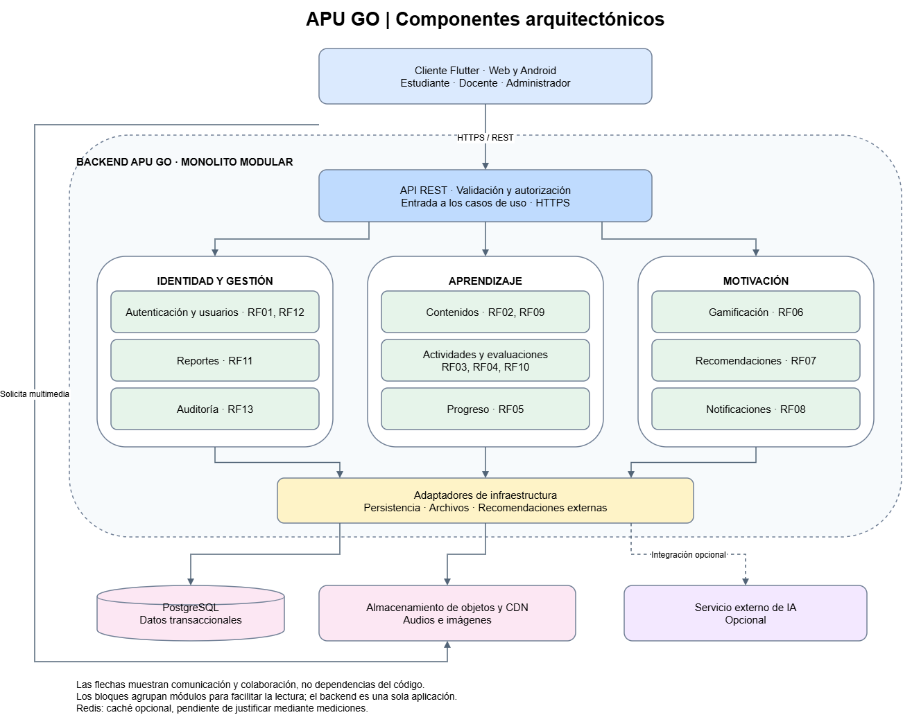
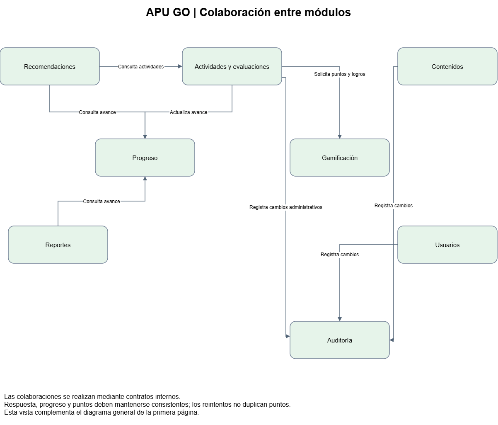

# Componentes arquitectónicos de APU GO

## Propósito

Identificar las responsabilidades principales de APU GO y relacionarlas con los requisitos funcionales.

El cliente Flutter permite acceder desde Web y Android. El backend se organiza como un monolito modular: sus módulos tienen responsabilidades separadas, pero se despliegan como una sola aplicación.

## Componentes principales

| Componente | Responsabilidad | Requisitos relacionados |
|---|---|---|
| Cliente Flutter | Presentar las lecciones, actividades y funciones disponibles según el rol. | RF01–RF13 |
| API REST | Recibir solicitudes HTTPS, validar su formato y delegar su atención a los casos de uso. | RF01–RF13 |
| Autenticación y usuarios | Autenticar usuarios, administrar cuentas y verificar permisos según el rol. | RF01, RF12 |
| Contenidos educativos | Consultar y gestionar lecciones y referencias a recursos multimedia. | RF02, RF09 |
| Actividades y evaluaciones | Gestionar actividades, registrar respuestas y evaluar resultados. | RF03, RF04, RF10 |
| Progreso | Registrar y consultar el avance de cada estudiante. | RF05 |
| Gamificación | Aplicar las reglas para otorgar puntos y logros. | RF06 |
| Recomendaciones | Seleccionar actividades de refuerzo según el progreso del estudiante. | RF07 |
| Notificaciones | Generar y mostrar avisos de aprendizaje. | RF08 |
| Reportes | Elaborar información de progreso para los docentes autorizados. | RF11 |
| Auditoría | Registrar y consultar acciones administrativas relevantes. | RF13 |

## Diagrama de componentes

*Figura 1. Componentes arquitectónicos de APU GO. Fuente: elaboración propia.*

### Colaboración entre módulos

*Figura 2. Colaboración entre módulos. Fuente: elaboración propia.*

## Organización interna

Los módulos respetan Clean Architecture:

| Capa | Responsabilidad |
|---|---|
| Dominio | Entidades y reglas del aprendizaje, evaluación y gamificación. |
| Aplicación | Casos de uso y contratos para persistencia y servicios externos. |
| Presentación | Controladores REST y transformación de solicitudes y respuestas. |
| Infraestructura | Implementaciones de los contratos mediante PostgreSQL, almacenamiento de objetos y servicios externos. |

El dominio no depende de frameworks, bases de datos ni proveedores externos.

## Colaboración principal: resolver una actividad

1. El estudiante envía una respuesta desde Flutter.
2. La API verifica la identidad, los permisos y el formato de la solicitud.
3. El caso de uso de actividades evalúa la respuesta mediante las reglas del dominio.
4. Se actualizan el progreso y los puntos correspondientes.
5. Los resultados se guardan mediante los contratos de persistencia.
6. La API devuelve al cliente la evaluación y el avance actualizado.

El registro de la respuesta, el progreso y los puntos debe mantener consistencia. Repetir una misma solicitud no debe otorgar puntos duplicados.

## Datos y servicios de apoyo

| Elemento | Uso |
|---|---|
| PostgreSQL | Usuarios, lecciones, actividades, respuestas, progreso, puntos, logros y auditoría. |
| Almacenamiento de objetos | Archivos de audio e imágenes; PostgreSQL conserva sus referencias. |
| CDN | Distribución de recursos multimedia al cliente. |
| Servicio externo de IA | Integración opcional mediante un contrato de recomendaciones. |
| Redis | Caché opcional cuando las mediciones justifiquen incorporarla. |

## Relación con las decisiones arquitectónicas

- ADR-001: módulos desplegados como una sola aplicación backend.
- ADR-002: separación interna mediante Clean Architecture.
- ADR-003: comunicación con Flutter mediante REST sobre HTTPS.
- ADR-005: autorización por roles y minimización de datos personales.
- ADR-006: separación de datos transaccionales y archivos multimedia.
- ADR-008: recomendaciones desacopladas de un proveedor externo de IA.

## Estado

Los componentes representan el diseño propuesto. Su funcionamiento y sus atributos de calidad deberán verificarse durante la implementación.