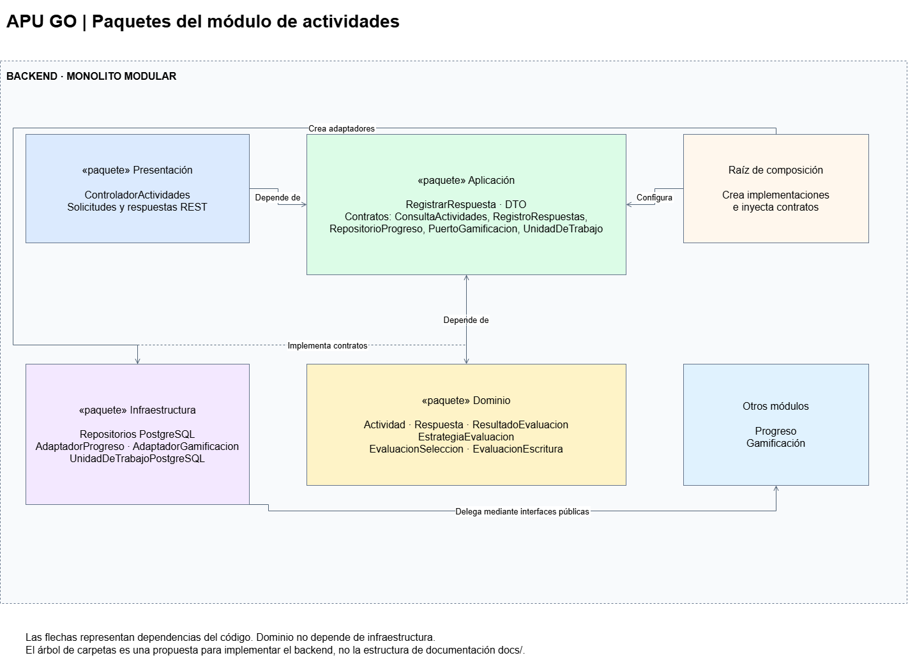
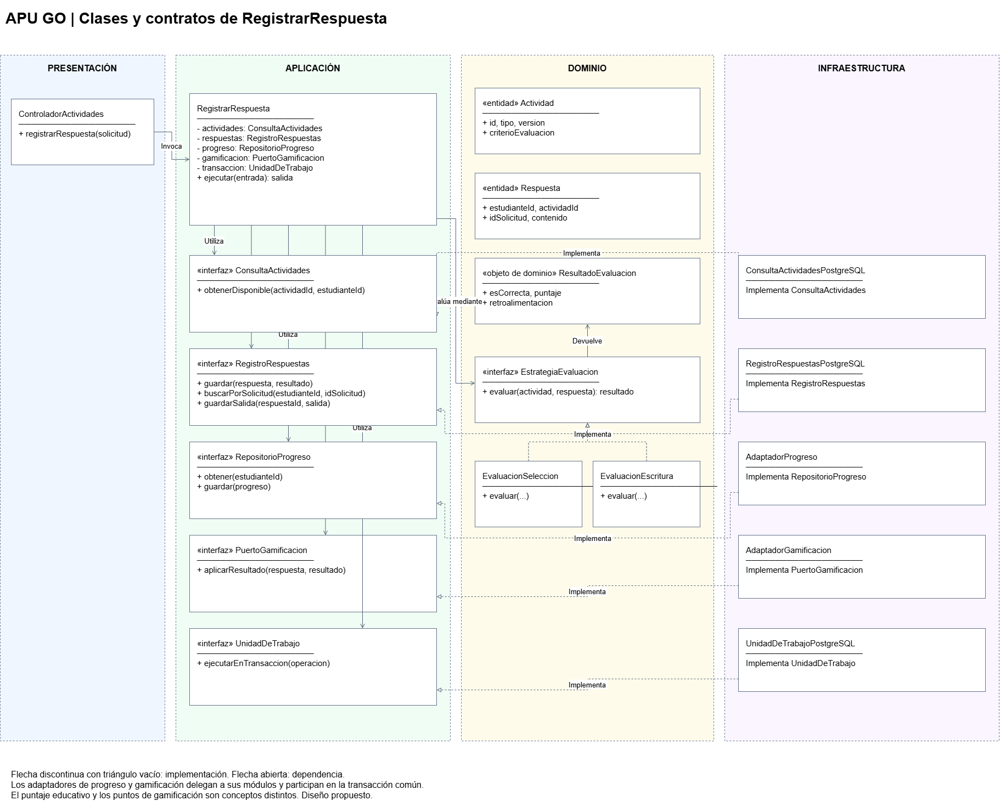
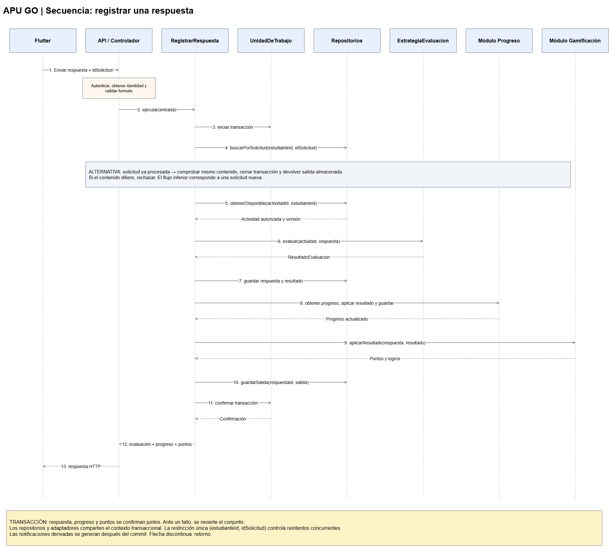

# Diseño interno de módulos de APU GO

## 1. Propósito

Describir la estructura interna del módulo de actividades de APU GO, sus clases, contratos y colaboraciones para registrar una respuesta.

Este módulo se relaciona con progreso y gamificación mediante interfaces internas del monolito modular.

El documento representa un diseño propuesto, pendiente de implementación.

## 2. Estructura de carpetas

La organización lógica propuesta para el backend es:

```text
backend/
└── modulos/
    └── actividades/
        ├── dominio/
        │   ├── entidades/
        │   │   ├── Actividad
        │   │   ├── Respuesta
        │   │   └── ResultadoEvaluacion
        │   └── evaluacion/
        │       ├── EstrategiaEvaluacion
        │       ├── EvaluacionSeleccion
        │       └── EvaluacionEscritura
        ├── aplicacion/
        │   ├── casos-de-uso/
        │   │   └── RegistrarRespuesta
        │   ├── contratos/
        │   │   ├── ConsultaActividades
        │   │   ├── RegistroRespuestas
        │   │   ├── RepositorioProgreso
        │   │   ├── PuertoGamificacion
        │   │   └── UnidadDeTrabajo
        │   └── dto/
        │       ├── RegistrarRespuestaEntrada
        │       └── RegistrarRespuestaSalida
        ├── infraestructura/
        │   ├── persistencia/
        │   │   ├── ConsultaActividadesPostgreSQL
        │   │   ├── RegistroRespuestasPostgreSQL
        │   │   └── UnidadDeTrabajoPostgreSQL
        │   └── integracion/
        │       ├── AdaptadorProgreso
        │       └── AdaptadorGamificacion
        └── presentacion/
            └── ControladorActividades
```

Los nombres representan responsabilidades y no fijan todavía la extensión de los archivos ni el framework del backend.

RepositorioProgreso pertenece a los contratos que consume el caso de uso. AdaptadorProgreso delega las operaciones al módulo de progreso, cuya implementación de persistencia utiliza PostgreSQL.

La raíz de composición conecta las implementaciones concretas con los contratos.

## 3. Capas y regla de dependencia

| Capa | Elementos | Responsabilidad |
|---|---|---|
| Dominio | Actividad, Respuesta, ResultadoEvaluacion y estrategias | Representar los conceptos y aplicar las reglas de evaluación. |
| Aplicación | RegistrarRespuesta, DTO y contratos | Coordinar la operación de aprendizaje. |
| Presentación | ControladorActividades | Recibir solicitudes REST y construir respuestas HTTP. |
| Infraestructura | Repositorios PostgreSQL y adaptadores internos | Implementar persistencia y comunicación con otros módulos. |

### Dependencias permitidas

- Aplicación depende de dominio.
- Presentación depende de aplicación.
- Infraestructura implementa contratos definidos en aplicación.
- Dominio no depende de frameworks, bases de datos ni controladores.
- La raíz de composición conoce las implementaciones necesarias para construir la aplicación.

Las dependencias del código apuntan hacia el núcleo. El flujo de ejecución puede llamar a infraestructura mediante los contratos inyectados.



## 4. Clases y contratos principales

| Elemento | Tipo | Responsabilidad | Operaciones o datos principales |
|---|---|---|---|
| Actividad | Entidad | Representar el ejercicio y sus condiciones de evaluación. | id, tipo, version, contenido y criterio de evaluación. |
| Respuesta | Entidad | Representar el intento enviado por el estudiante. | id, estudianteId, actividadId, idSolicitud y contenido. |
| ResultadoEvaluacion | Objeto de dominio | Comunicar el resultado de la evaluación. | esCorrecta, puntaje y retroalimentacion. |
| EstrategiaEvaluacion | Interfaz | Definir el contrato de evaluación. | evaluar(actividad, respuesta). |
| EvaluacionSeleccion | Implementación | Evaluar una actividad de selección. | evaluar(actividad, respuesta). |
| EvaluacionEscritura | Implementación | Evaluar una respuesta escrita según reglas educativas validadas. | evaluar(actividad, respuesta). |
| RegistrarRespuesta | Caso de uso | Coordinar evaluación, persistencia, progreso y puntos. | ejecutar(entrada). |
| ConsultaActividades | Contrato | Obtener actividades disponibles para el estudiante. | obtenerDisponible(actividadId, estudianteId). |
| RegistroRespuestas | Contrato | Guardar intentos y recuperar resultados ya procesados. | guardar(respuesta, resultado), buscarPorSolicitud(estudianteId, idSolicitud). |
| RepositorioProgreso | Contrato | Consultar y guardar el avance. | obtener(estudianteId), guardar(progreso). |
| PuertoGamificacion | Contrato | Solicitar la aplicación de reglas de puntos y logros. | aplicarResultado(respuesta, resultado). |
| UnidadDeTrabajo | Contrato | Coordinar cambios que deben confirmarse juntos. | ejecutarEnTransaccion(operacion). |
| ControladorActividades | Controlador REST | Validar formato y delegar al caso de uso. | registrarRespuesta(solicitud). |

ResultadoEvaluacion.puntaje expresa la calificación educativa. Los puntos de gamificación se calculan mediante reglas propias y no necesariamente coinciden con esa calificación.

### 4.1. Notación UML utilizada

- Clase: entidad, caso de uso o implementación concreta.
- «interface»: contrato que puede tener distintas implementaciones.
- Flecha discontinua con triángulo vacío: implementación de una interfaz.
- Flecha de dependencia: un elemento utiliza otro.
- `+`: operación o atributo público.
- `-`: atributo privado.



## 5. Flujo de ejecución: registrar una respuesta

1. El estudiante envía la respuesta desde Flutter, incluyendo un identificador de solicitud.
2. La API autentica al usuario y obtiene su identidad de la sesión validada.
3. El controlador valida el formato y llama a RegistrarRespuesta.
4. El caso de uso inicia una unidad de trabajo.
5. Comprueba si la solicitud ya fue procesada para ese estudiante.
6. Si existe, devuelve el resultado almacenado sin repetir los cambios.
7. Obtiene la actividad y verifica que esté disponible para el estudiante.
8. Selecciona una estrategia compatible y evalúa la respuesta.
9. Guarda el intento y su resultado.
10. Actualiza el progreso mediante el contrato correspondiente.
11. Solicita al módulo de gamificación los puntos y logros aplicables.
12. Confirma conjuntamente los cambios.
13. Devuelve la evaluación, el progreso y los puntos al cliente.

Si falla una operación que pertenece a la transacción, los cambios se revierten.

Los avisos derivados se generan después de confirmar la operación. Su fallo no debe revertir una respuesta ya registrada.



## 6. Reglas de consistencia

| Regla | Aplicación |
|---|---|
| Identidad confiable | El estudiante se identifica mediante la sesión; no se confía en un identificador enviado libremente por el cliente. |
| Disponibilidad de la actividad | Solo se procesan actividades que el estudiante puede resolver. |
| Evaluación compatible | La estrategia seleccionada corresponde al tipo de actividad. |
| Registro atómico | Respuesta, progreso y puntos se confirman juntos cuando forman parte de la misma operación. |
| Reintentos seguros | La combinación estudianteId e idSolicitud debe ser única. |
| Solicitud coherente | Reutilizar un idSolicitud con contenido distinto debe rechazarse de forma controlada. |
| Puntos sin duplicación | Reenviar una solicitud procesada devuelve el resultado existente y no vuelve a otorgar puntos. |
| Control de concurrencia | Las actualizaciones de progreso y puntos deben evitar pérdidas de cambios ante solicitudes simultáneas. |

Los adaptadores de progreso y gamificación deben participar en la misma transacción PostgreSQL para cumplir la atomicidad propuesta. Si posteriormente se separan en servicios independientes, esta estrategia deberá revisarse.

## 7. Código de referencia

### 7.1. Dominio: contrato de evaluación

```text
interfaz EstrategiaEvaluacion:
    evaluar(actividad, respuesta) -> ResultadoEvaluacion
```

Las implementaciones de selección y escritura respetan el mismo contrato.

### 7.2. Aplicación: caso de uso

```text
RegistrarRespuesta.ejecutar(entrada):

    validarEntrada(entrada)

    devolver unidadDeTrabajo.ejecutarEnTransaccion:

        existente = respuestas.buscarPorSolicitud(
            entrada.estudianteId,
            entrada.idSolicitud
        )

        si existente:
            comprobarMismoContenido(existente, entrada)
            devolver existente.salidaRegistrada

        actividad = actividades.obtenerDisponible(
            entrada.actividadId,
            entrada.estudianteId
        )

        estrategia = selector.obtener(actividad.tipo)
        respuesta = construirRespuesta(entrada, actividad.version)
        resultado = estrategia.evaluar(actividad, respuesta)

        respuestas.guardar(respuesta, resultado)

        avance = progreso.obtener(entrada.estudianteId)
        avance.registrarResultado(respuesta, resultado)
        progreso.guardar(avance)

        premios = gamificacion.aplicarResultado(
            respuesta,
            resultado
        )

        salida = construirSalida(resultado, avance, premios)
        respuestas.guardarSalida(respuesta.id, salida)

        devolver salida
```

Este pseudocódigo resume el flujo. La implementación debe resolver los reintentos concurrentes mediante una restricción única y un manejo transaccional del conflicto; una consulta previa no basta por sí sola.

La operación guardarSalida forma parte del contrato de registro y permite devolver la misma respuesta ante un reintento.

### 7.3. Infraestructura: persistencia

RegistroRespuestasPostgreSQL implementa el contrato RegistroRespuestas.

Sus operaciones utilizan consultas parametrizadas o un ORM y participan en el contexto transaccional proporcionado por UnidadDeTrabajoPostgreSQL.

La base de datos debe incluir una restricción única sobre estudianteId e idSolicitud.

### 7.4. Presentación: controlador

El controlador:

- Obtiene la identidad autenticada.
- Valida los campos de la solicitud.
- Construye el DTO de entrada.
- Invoca RegistrarRespuesta.
- Transforma el resultado a una respuesta HTTP.
- Comunica errores de forma controlada, sin revelar detalles internos.

### 7.5. Raíz de composición

La configuración de la aplicación crea e inyecta:

- ConsultaActividadesPostgreSQL.
- RegistroRespuestasPostgreSQL.
- AdaptadorProgreso.
- AdaptadorGamificacion.
- UnidadDeTrabajoPostgreSQL.
- Selector de estrategias de evaluación.
- RegistrarRespuesta.
- ControladorActividades.

## 8. Relación con patrones y SOLID

| Elemento | Patrón o principio |
|---|---|
| Contratos de persistencia | Repository e inversión de dependencias. |
| Estrategias de evaluación | Strategy, abierto/cerrado y sustitución de Liskov. |
| Adaptadores de progreso y gamificación | Adapter y separación entre módulos. |
| Controlador separado del caso de uso | Responsabilidad única. |
| Contratos según operaciones necesarias | Segregación de interfaces. |

## 9. Trazabilidad

| Función del diseño | Requisito relacionado |
|---|---|
| Registrar respuestas | RF03 |
| Evaluar y mostrar resultados | RF04 |
| Actualizar progreso | RF05 |
| Asignar puntos y logros | RF06 |

El diseño responde también a AC04: seguridad, AC05: mantenibilidad, DA06: evolución modular y ADR-002: Clean Architecture.

## 10. Relación con el tutor IA obligatorio

RegistrarRespuesta continúa utilizando estrategias del dominio y transacciones PostgreSQL. ConsultarTutorIA pertenece al módulo Tutor IA y recomendaciones y utiliza ServicioTutorIA, implementado por AdaptadorGroq. La asistencia contextual no reemplaza la evaluación ni modifica puntos. El diseño del tutor y sus fallos se documenta en [Integración con Groq](../../02-arquitectura-software/integracion-groq.md).
