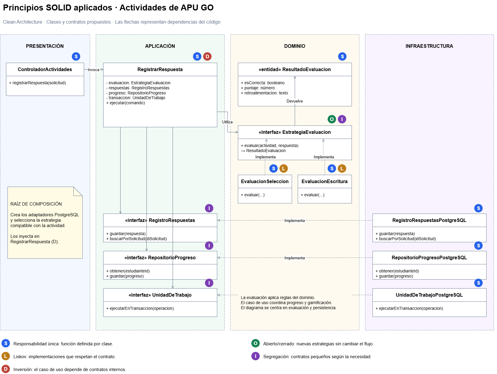

# Principios de diseño SOLID de APU GO

## Objetivo

Definir cómo se aplicarán los principios SOLID para separar responsabilidades, controlar las dependencias y facilitar la evolución del backend de APU GO.

## Contexto

Se toma como ejemplo el módulo de actividades y su caso de uso RegistrarRespuesta.

Este caso de uso coordina la evaluación de una respuesta, la actualización del progreso y la asignación de puntos. Las reglas de evaluación pertenecen al dominio y el acceso a PostgreSQL se realiza mediante contratos.

La aplicación de estos principios es una propuesta que deberá verificarse durante la implementación.

## SOLID en el módulo de actividades

| Principio | Aplicación en APU GO | Elementos propuestos |
|---|---|---|
| S: Responsabilidad única | Separar la recepción de solicitudes, la coordinación del caso de uso, la evaluación y la persistencia. | ControladorActividades, RegistrarRespuesta, EstrategiaEvaluacion y repositorios. |
| O: Abierto/cerrado | Permitir incorporar una nueva forma de evaluación mediante otra estrategia, conservando el contrato y el flujo general del caso de uso. | EvaluacionSeleccion y EvaluacionEscritura implementan EstrategiaEvaluacion. |
| L: Sustitución de Liskov | Todas las estrategias deben respetar las entradas, salidas y condiciones del contrato de evaluación. | Cada estrategia devuelve un ResultadoEvaluacion válido para el tipo de actividad que admite. |
| I: Segregación de interfaces | Definir contratos pequeños según las operaciones que necesita cada consumidor. | ConsultaActividades, RegistroRespuestas y RepositorioProgreso. |
| D: Inversión de dependencias | Los casos de uso dependen de contratos internos; infraestructura proporciona sus implementaciones. | RegistrarRespuesta utiliza RegistroRespuestas; RegistroRespuestasPostgreSQL implementa ese contrato. |

## Diagrama SOLID del módulo de actividades

*Figura. Clases y contratos propuestos para aplicar SOLID en APU GO. Fuente: elaboración propia.*

## 1. Responsabilidad única

Cada elemento tiene una responsabilidad definida:

| Elemento | Responsabilidad |
|---|---|
| ControladorActividades | Validar el formato de la solicitud y transformar la respuesta HTTP. |
| RegistrarRespuesta | Coordinar la operación de registrar y evaluar una respuesta. |
| EstrategiaEvaluacion | Aplicar las reglas correspondientes al tipo de actividad. |
| ServicioGamificacion | Determinar los puntos y logros según las reglas del dominio. |
| Repositorios | Guardar y recuperar información mediante los contratos establecidos. |
| UnidadDeTrabajo | Coordinar la confirmación o reversión de los cambios que deben persistirse juntos. |

El controlador no contiene las reglas de evaluación ni instrucciones SQL.

## 2. Abierto/cerrado

Los tipos de actividad pueden requerir evaluaciones diferentes.

Se propone el contrato EstrategiaEvaluacion, con implementaciones como:

- EvaluacionSeleccion.
- EvaluacionEscritura.

Una nueva forma de evaluación se agrega mediante otra implementación. La selección se configura fuera del caso de uso, evitando modificar su flujo general por cada tipo nuevo.

Este principio no significa que el código nunca pueda cambiar, sino que se definan puntos de extensión para las variaciones previstas.

## 3. Sustitución de Liskov

Las implementaciones deben respetar el contrato de evaluación:

- Admitir las entradas definidas para el tipo de actividad correspondiente.
- Devolver un ResultadoEvaluacion con el mismo significado y estructura.
- No modificar datos persistidos como efecto secundario.
- Comunicar entradas inválidas mediante el mecanismo acordado.
- No exigir condiciones adicionales que contradigan el contrato.

El selector entrega al caso de uso una estrategia compatible con la actividad. Las diferencias de evaluación no deben romper el procesamiento del resultado.

## 4. Segregación de interfaces

Se evitará un contrato general que reúna todas las operaciones del sistema.

| Contrato | Operaciones necesarias |
|---|---|
| ConsultaActividades | Obtener una actividad y consultar las actividades disponibles. |
| RegistroRespuestas | Guardar una respuesta y comprobar si una solicitud ya fue procesada. |
| RepositorioProgreso | Consultar y guardar el progreso del estudiante. |
| ServicioRecomendaciones | Obtener actividades sugeridas a partir de datos permitidos de aprendizaje. |

Cada consumidor depende únicamente de las operaciones que utiliza.

Una misma implementación puede satisfacer varios contratos sin obligar a los consumidores a conocerlos todos.

## 5. Inversión de dependencias

Los contratos de persistencia se definen en la capa de aplicación y sus implementaciones concretas pertenecen a infraestructura.

Ejemplo:

- RegistrarRespuesta depende del contrato RegistroRespuestas.
- RegistroRespuestasPostgreSQL implementa ese contrato.
- La raíz de composición crea los objetos e inyecta la implementación en el caso de uso.

El caso de uso no importa el cliente de PostgreSQL ni ejecuta instrucciones SQL.

Durante las pruebas, se puede utilizar una implementación en memoria que respete el mismo contrato.

## Qué ocurriría sin SOLID

| Problema de diseño | Consecuencia |
|---|---|
| Controlador con validaciones, evaluación y SQL mezclados | Un cambio de persistencia puede afectar la atención de solicitudes y las reglas educativas. |
| Evaluación concentrada en condiciones crecientes | Incorporar actividades nuevas exige modificar repetidamente la misma lógica. |
| Estrategias con resultados incompatibles | El caso de uso necesita excepciones para procesar cada implementación. |
| Contratos demasiado amplios | Los consumidores quedan vinculados a operaciones que no necesitan. |
| Casos de uso dependientes de PostgreSQL | Las pruebas requieren infraestructura y los cambios tecnológicos afectan la aplicación. |

## Relación con Clean Architecture y los patrones

| Elemento | Relación con SOLID |
|---|---|
| Clean Architecture | Separa responsabilidades y orienta las dependencias hacia las reglas del negocio. |
| Repository | Permite invertir las dependencias de persistencia y definir contratos específicos. |
| Strategy | Ofrece un punto de extensión para distintas reglas de evaluación. |
| Adapter | Encapsula la transformación requerida por una tecnología o un servicio externo. |
| Decorator | Agrega caché manteniendo el contrato de consulta del repositorio original. |

## Verificación propuesta

- Revisar que los controladores no contengan reglas educativas ni SQL.
- Comprobar que las estrategias cumplan el mismo contrato de resultados.
- Probar RegistrarRespuesta utilizando repositorios de prueba.
- Inspeccionar que dominio y aplicación no dependan de infraestructura.
- Verificar que una nueva estrategia pueda incorporarse sin modificar el flujo general del caso de uso.

## Trazabilidad

Este diseño responde a:

- AC05: mantenibilidad.
- DA06: mantenibilidad y evolución modular.
- ADR-002: aplicación de Clean Architecture.