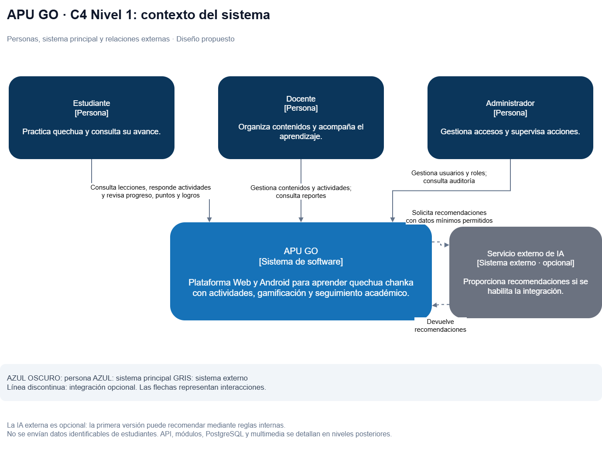

# Nivel 1 · Diagrama de contexto de APU GO

## 1. Objetivo

Mostrar quiénes utilizan APU GO, qué necesitan realizar y con qué sistemas externos se relaciona.

Este nivel presenta APU GO como un único sistema. Sus aplicaciones, módulos y bases de datos se detallan en los siguientes niveles.

## 2. Diagrama

*Figura. C4 nivel 1: contexto de APU GO. Fuente: elaboración propia.*

## 3. Personas

| Persona | Necesidad | Interacción con APU GO |
|---|---|---|
| Estudiante | Practicar quechua chanka y conocer su avance. | Consulta lecciones, responde actividades y revisa progreso, puntos, logros y recomendaciones. |
| Docente | Organizar el aprendizaje y acompañar a sus estudiantes. | Gestiona lecciones y actividades; consulta reportes de los estudiantes a su cargo. |
| Administrador | Supervisar el funcionamiento y controlar los accesos. | Gestiona usuarios y roles; consulta las acciones administrativas registradas. |

## 4. Sistemas

| Sistema | Tipo | Responsabilidad |
|---|---|---|
| APU GO | Sistema principal | Ofrecer aprendizaje de quechua chanka mediante contenidos, actividades, gamificación y seguimiento académico. |
| Servicio externo de IA | Sistema externo opcional | Proporcionar recomendaciones si se habilita una integración que respete los requisitos de privacidad. |

PostgreSQL, la API REST y los módulos del backend forman parte de la solución; no se representan como sistemas externos en este nivel.

El almacenamiento multimedia y la CDN se detallarán en el nivel de contenedores.

## 5. Relaciones

| Origen | Destino | Relación | Requisitos relacionados |
|---|---|---|---|
| Estudiante | APU GO | Inicia sesión y utiliza las funciones de aprendizaje. | RF01–RF08 |
| Docente | APU GO | Inicia sesión, gestiona contenidos y actividades, y consulta reportes. | RF01, RF09–RF11 |
| Administrador | APU GO | Inicia sesión, gestiona usuarios y consulta auditoría. | RF01, RF12, RF13 |
| APU GO | Servicio externo de IA | Solicita recomendaciones mediante un adaptador opcional. | RF07, AC06, ADR-008 |
| Servicio externo de IA | APU GO | Devuelve recomendaciones para su procesamiento interno. | RF07 |

## 6. Decisiones y supuestos

- APU GO ofrecerá acceso desde Web y Android.
- Estudiantes, docentes y administradores tendrán permisos diferentes.
- Los docentes únicamente podrán consultar información de los estudiantes autorizados.
- La integración externa de IA es opcional.
- La versión inicial puede recomendar actividades mediante reglas internas.
- No se enviarán datos identificables de estudiantes al proveedor externo.
- Las relaciones del diagrama representan interacciones con el sistema, no dependencias del código.

### Pendientes por definir

- Proveedor externo de IA, si se decide utilizarlo.
- Campos de aprendizaje permitidos para la integración.
- Organización de grupos y asignación de estudiantes a docentes.