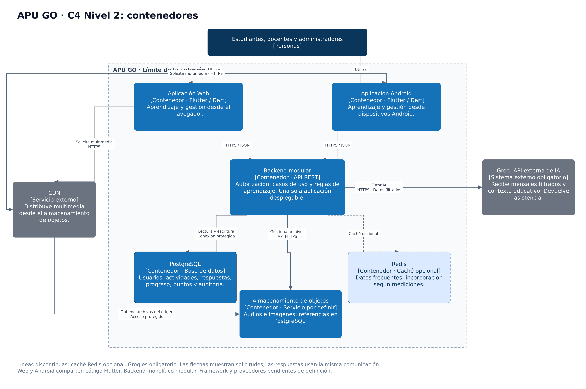

# Nivel 2 · Diagrama de contenedores de APU GO

## 1. Objetivo

Mostrar las aplicaciones, los almacenes de datos y los servicios externos que participan en APU GO, identificando sus responsabilidades y comunicaciones.

El backend se mantiene como una única aplicación desplegable. Sus módulos internos se detallarán en el nivel 3.

## 2. Diagrama

*Figura. C4 nivel 2: contenedores de APU GO. Fuente: elaboración propia.*

Las flechas representan solicitudes o acceso a recursos. Las respuestas circulan por las mismas comunicaciones y no se dibujan por separado.

## 3. Contenedores

| Contenedor | Tecnología propuesta | Responsabilidad |
|---|---|---|
| Aplicación Web | Flutter y Dart | Permitir el acceso desde el navegador a las funciones autorizadas. |
| Aplicación Android | Flutter y Dart | Permitir el acceso desde dispositivos Android. |
| Backend modular | API REST sobre HTTPS; framework por definir | Ejecutar los casos de uso y las reglas de aprendizaje, controlar permisos y coordinar la persistencia. |
| Base de datos | PostgreSQL | Almacenar usuarios, contenidos estructurados, actividades, respuestas, progreso, puntos, logros y auditoría. |
| Almacenamiento de objetos | Servicio por definir | Guardar audios e imágenes. PostgreSQL conserva sus referencias y metadatos. |
| Caché opcional | Redis | Almacenar temporalmente datos de consulta frecuente cuando las pruebas justifiquen su incorporación. |

Las aplicaciones Web y Android comparten una base de código Flutter, pero constituyen aplicaciones ejecutadas en entornos diferentes.

Los almacenes gestionados por proveedores siguen formando parte de la solución. Su ubicación concreta se establecerá en el diseño de despliegue.

## 4. Sistemas externos

| Sistema | Responsabilidad | Condición |
|---|---|---|
| CDN | Distribuir recursos multimedia desde el almacenamiento de objetos. | Su proveedor y configuración están pendientes de definición. |
| Groq: API externa de IA | Proporcionar tutoría contextualizada y apoyar las recomendaciones previstas mediante AdaptadorGroq. | Integración obligatoria; modelo, cuotas y límites operativos por configurar. |

## 5. Relaciones

| Origen | Destino | Comunicación | Información intercambiada |
|---|---|---|---|
| Personas | Aplicaciones Web y Android | Interfaz de usuario | Acciones de aprendizaje y gestión según el rol. |
| Aplicaciones | Backend | HTTPS con solicitudes y respuestas JSON | Autenticación, lecciones, actividades, respuestas, progreso y reportes. |
| Backend | PostgreSQL | Conexión de base de datos protegida | Lectura y escritura de datos transaccionales. |
| Backend | Almacenamiento de objetos | API del proveedor mediante HTTPS | Gestión de archivos y sus referencias. |
| Aplicaciones | CDN | HTTPS | Solicitudes de audios e imágenes. |
| CDN | Almacenamiento de objetos | Acceso protegido al origen | Recuperación de recursos multimedia. |
| Backend | Redis | Conexión interna protegida | Consultas, almacenamiento e invalidación de caché. |
| Backend | Groq | HTTPS | Mensajes e historial filtrados, contexto educativo mínimo y respuestas del tutor. |

Los clientes no acceden directamente a PostgreSQL ni a Redis.

## 6. Decisiones arquitectónicas reflejadas

| Decisión | Representación en este nivel |
|---|---|
| ADR-001: monolito modular | Un único contenedor backend para los módulos de negocio. |
| ADR-002: Clean Architecture | Organización interna del backend, que se detallará en los siguientes niveles. |
| ADR-003: API REST sobre HTTPS | Ambos clientes consumen el mismo backend. |
| ADR-004: caché según mediciones | Redis aparece como un elemento opcional. |
| ADR-005: seguridad y privacidad | El backend controla permisos y limita los datos enviados al exterior. |
| ADR-006: multimedia separada | PostgreSQL y almacenamiento de objetos tienen responsabilidades distintas. |
| ADR-008: integración obligatoria con Groq | El backend utiliza ServicioTutorIA y AdaptadorGroq para el tutor, además del contrato ServicioRecomendaciones. |

## 7. Seguridad entre contenedores

- Las aplicaciones se comunican con el backend mediante HTTPS.
- El backend verifica identidad, rol y autorización sobre cada recurso.
- Las credenciales de PostgreSQL y los proveedores permanecen en el entorno del backend.
- Las contraseñas se almacenan mediante un hash adecuado para contraseñas.
- PostgreSQL y Redis no se exponen directamente a los clientes.
- El acceso a archivos privados se controla mediante mecanismos del proveedor, como enlaces firmados.
- La integración de IA excluye datos identificables de estudiantes.
- Los registros técnicos no deben incluir contraseñas, tokens ni información personal innecesaria.

## 8. Supuestos y pendientes

- Definir el framework del backend y los proveedores de infraestructura.
- Definir cómo se publicará y servirá la aplicación Flutter Web.
- Configurar autenticación, autorización y acceso a multimedia.
- Validar las metas de concurrencia mediante pruebas de carga.
- Incorporar Redis únicamente si las mediciones lo justifican.
- Documentar balanceador, réplicas, respaldos y monitoreo en una vista de despliegue.

Las réplicas del backend representan instancias del mismo contenedor; no se dibujan como módulos independientes en esta vista lógica.
