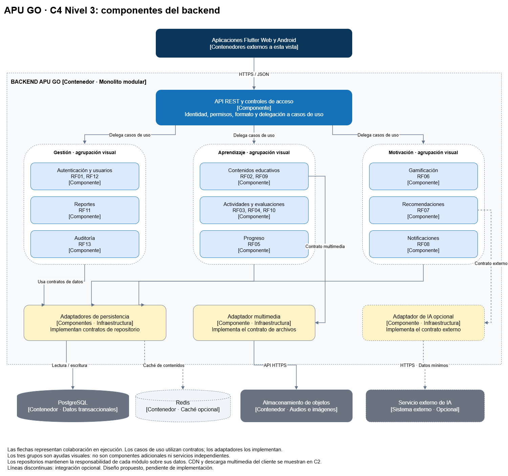
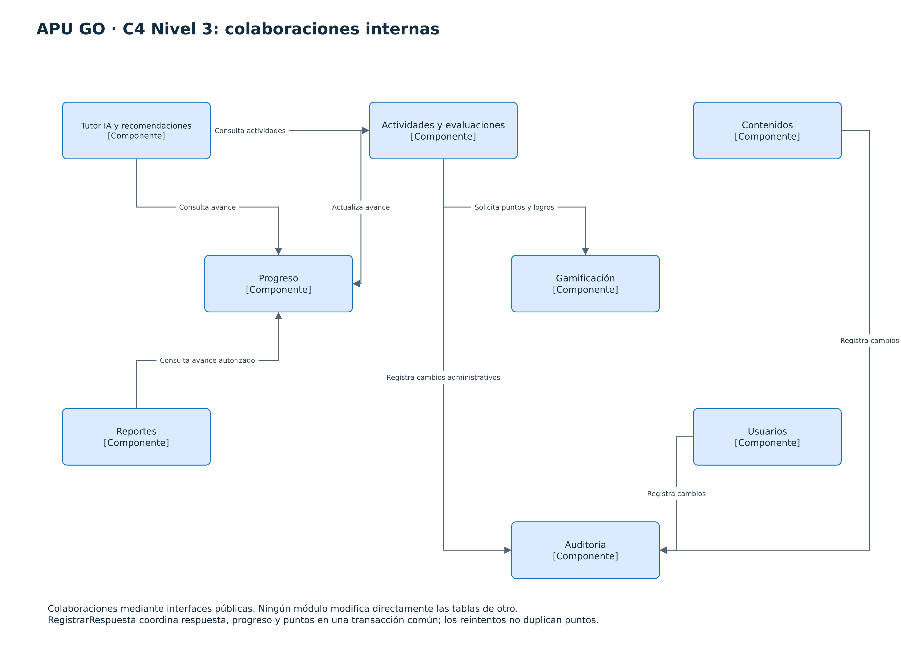

# Nivel 3 · Diagrama de componentes de APU GO

## 1. Objetivo

Describir los componentes internos del backend de APU GO, sus responsabilidades y colaboraciones.

El contenedor analizado es el backend modular identificado en el nivel 2. Los componentes se ejecutan dentro de una sola aplicación desplegable; no representan microservicios.

## 2. Diagrama

*Figura 1. C4 nivel 3: componentes del backend.*

*Figura 2. Colaboraciones entre componentes. Fuente: elaboración propia.*

## 3. Componentes

| Componente | Responsabilidad | Requisitos relacionados |
|---|---|---|
| API REST y controles de acceso | Recibir solicitudes, verificar identidad y permisos, validar su formato y delegar a los casos de uso. | RF01–RF14 |
| Autenticación y usuarios | Autenticar usuarios y gestionar cuentas y roles. | RF01, RF12 |
| Contenidos educativos | Consultar y gestionar lecciones y referencias a recursos multimedia. | RF02, RF09 |
| Actividades y evaluaciones | Gestionar ejercicios, registrar respuestas y evaluar resultados. | RF03, RF04, RF10 |
| Progreso | Registrar y consultar el avance de cada estudiante. | RF05 |
| Gamificación | Aplicar reglas para otorgar puntos y logros. | RF06 |
| Tutor IA y recomendaciones | Atender consultas educativas con Groq y seleccionar actividades de refuerzo según el avance. | RF07, RF14 |
| Notificaciones | Generar y mostrar avisos relacionados con el aprendizaje. | RF08 |
| Reportes | Elaborar reportes para docentes autorizados. | RF11 |
| Auditoría | Registrar y consultar acciones administrativas relevantes. | RF13 |
| Adaptadores de persistencia | Implementar los contratos de acceso a datos mediante PostgreSQL. | Requisitos que necesitan persistencia |
| Adaptador multimedia | Gestionar archivos mediante la API del almacenamiento de objetos. | RF02, RF09 |
| AdaptadorGroq obligatorio | Implementar ServicioTutorIA y la integración externa requerida por ServicioRecomendaciones, filtrar solicitudes y manejar errores de Groq. | RF14, RF07 |

Se conservan nueve módulos de negocio. Tutor IA y recomendaciones reúne RF14 y RF07 dentro de un mismo módulo. Los componentes de negocio agrupan sus casos de uso y reglas. Las responsabilidades de dominio, aplicación, presentación e infraestructura se detallan en el diseño interno.

## 4. Relaciones entre componentes

| Origen | Destino | Colaboración |
|---|---|---|
| API REST | Casos de uso de los módulos | Delegar una operación después de validar identidad, permisos y formato. |
| Actividades y evaluaciones | Progreso | Registrar el efecto de una respuesta sobre el avance del estudiante. |
| Actividades y evaluaciones | Gamificación | Solicitar la asignación de puntos y logros correspondientes. |
| Tutor IA y recomendaciones | Progreso | Consultar los resultados y temas que requieren refuerzo. |
| Tutor IA y recomendaciones | Actividades y evaluaciones | Consultar actividades disponibles para recomendar. |
| Reportes | Progreso | Obtener información de avance de los estudiantes autorizados. |
| Usuarios, contenidos y actividades | Auditoría | Registrar cambios administrativos relevantes. |
| Casos de uso | Contratos de persistencia | Solicitar operaciones de lectura y escritura. |
| Contenidos educativos | Contrato multimedia | Solicitar la gestión de audios e imágenes. |
| Tutor IA y recomendaciones | ServicioTutorIA y ServicioRecomendaciones | Solicitar asistencia externa a Groq mediante el adaptador obligatorio. |

Los adaptadores implementan los contratos utilizados por los casos de uso.

Las colaboraciones entre módulos pasan por interfaces públicas. Un módulo no importa las implementaciones internas de otro ni modifica directamente sus tablas.

## 5. Relaciones con contenedores y sistemas externos

| Componente del backend | Destino | Comunicación |
|---|---|---|
| API REST | Aplicaciones Flutter Web y Android | Recibe solicitudes HTTPS y devuelve respuestas JSON. |
| Adaptadores de persistencia | PostgreSQL | Lectura y escritura mediante conexiones protegidas. |
| Adaptador multimedia | Almacenamiento de objetos | Gestión de archivos mediante HTTPS. |
| Repositorio de contenidos con caché, si se incorpora | Redis | Consulta, almacenamiento temporal e invalidación. |
| AdaptadorGroq obligatorio | Groq: API externa de IA | Solicitudes HTTPS con mensajes filtrados y contexto mínimo permitido. |

Las aplicaciones solicitan multimedia a la CDN según la vista de nivel 2. La CDN no forma parte de los componentes internos del backend.

## 6. Reglas del monolito modular

- Los módulos tienen responsabilidades y contratos explícitos.
- El dominio no depende de frameworks ni de infraestructura.
- Los casos de uso dependen de contratos internos.
- Los adaptadores implementan esos contratos.
- La raíz de composición configura e inyecta las implementaciones.
- Los módulos comparten una instancia de PostgreSQL, pero mantienen la responsabilidad sobre sus propios datos.
- Las consultas entre módulos utilizan interfaces públicas.
- La autenticación y autorización se verifican en el backend.
- Los reintentos no deben duplicar respuestas ni puntos.
- Respuesta, progreso y puntos participan en una transacción común cuando se registran como una operación conjunta.

## 7. Flujo principal: registrar una respuesta

1. La API recibe la respuesta e identifica al estudiante autenticado.
2. El caso de uso RegistrarRespuesta verifica la actividad y el identificador de solicitud.
3. Una estrategia del dominio evalúa la respuesta.
4. Se registra el intento mediante el contrato de persistencia.
5. Se actualiza el progreso mediante una interfaz del módulo correspondiente.
6. Se aplican las reglas de gamificación.
7. Se confirman los cambios mediante la unidad de trabajo.
8. La API devuelve evaluación, progreso y puntos.

Si la solicitud ya se procesó con el mismo contenido, se devuelve la salida almacenada. Si ocurre un fallo antes de confirmar la transacción, se revierten los cambios.

## 8. Decisiones reflejadas

| Decisión | Aplicación |
|---|---|
| ADR-001 | Módulos dentro de una única aplicación backend. |
| ADR-002 | Separación de casos de uso, dominio y adaptadores. |
| ADR-004 | Caché opcional incorporada según mediciones. |
| ADR-005 | Autorización y minimización de datos personales. |
| ADR-006 | Persistencia transaccional separada de los archivos multimedia. |
| ADR-008 | Tutor con Groq obligatorio mediante contratos internos y adaptador. |

## 9. Estado

La vista representa el diseño propuesto. Las dependencias, transacciones y atributos de calidad deberán verificarse durante la implementación.

## 10. Flujo del tutor IA obligatorio

1. La API identifica al estudiante y autoriza su consulta (RF14).
2. ConsultarTutorIA obtiene el contexto educativo autorizado mediante interfaces de contenidos y progreso.
3. El filtro de datos depura mensaje, historial y contexto.
4. ServicioTutorIA delega a AdaptadorGroq, que envía la solicitud HTTPS con la clave del servidor.
5. El backend valida la salida y la devuelve al cliente. Los errores de cuota, proveedor o espera generan una respuesta controlada.

El tutor no escribe puntos ni participa en la transacción de RegistrarRespuesta. Los contratos se detallan en [Integración con Groq](../02-arquitectura-software/integracion-groq.md).
