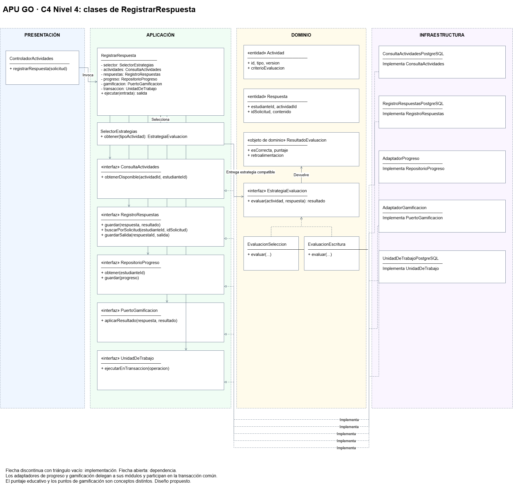
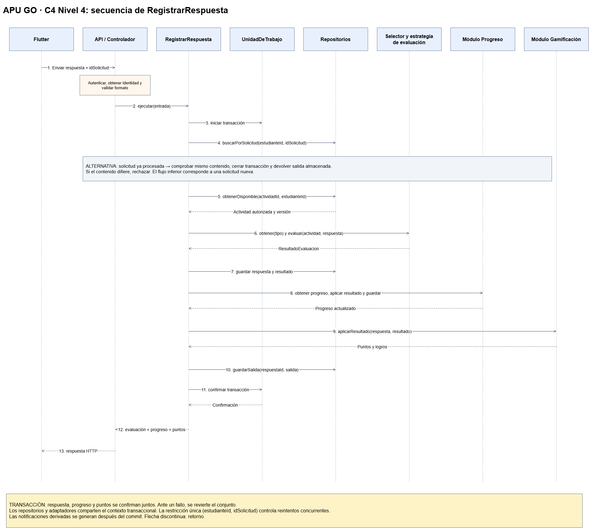
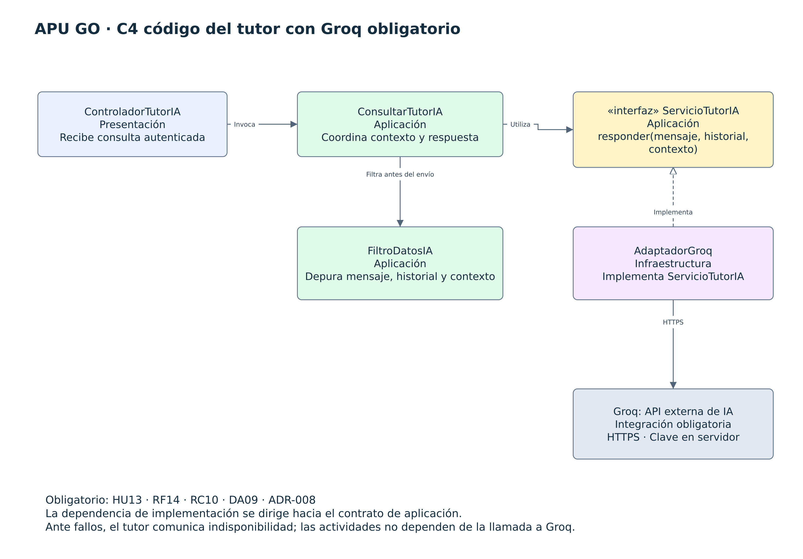

# Nivel 4 · Diagrama de código de APU GO

## 1. Objetivo

Detallar la estructura de clases, interfaces y métodos del caso de uso RegistrarRespuesta, perteneciente al componente Actividades y evaluaciones del nivel 3.

Esta vista incluye sus colaboraciones con progreso y gamificación. Representa un diseño propuesto; no implica que el código ya esté implementado.

## 2. Diagrama de clases

### 2.1. Capas de Clean Architecture

| Capa | Elementos principales |
|---|---|
| Dominio | Actividad, Respuesta, ResultadoEvaluacion, EstrategiaEvaluacion, EvaluacionSeleccion y EvaluacionEscritura. |
| Aplicación | RegistrarRespuesta, DTO de entrada y salida, selector de estrategias y contratos de persistencia y colaboración. |
| Presentación | ControladorActividades. |
| Infraestructura | Repositorios PostgreSQL, AdaptadorProgreso, AdaptadorGamificacion y UnidadDeTrabajoPostgreSQL. |

Los contratos de acceso a datos pertenecen a aplicación. El contrato EstrategiaEvaluacion pertenece al dominio porque describe una operación de evaluación educativa.

### 2.2. Entidades y estrategias del dominio

| Elemento | Responsabilidad | Datos u operaciones |
|---|---|---|
| Actividad | Representar el ejercicio y sus condiciones de evaluación. | id, tipo, version y criterioEvaluacion. |
| Respuesta | Representar el intento de un estudiante. | id, estudianteId, actividadId, idSolicitud y contenido. |
| ResultadoEvaluacion | Comunicar el resultado educativo. | esCorrecta, puntaje y retroalimentacion. |
| EstrategiaEvaluacion | Definir la operación común de evaluación. | evaluar(actividad, respuesta). |
| EvaluacionSeleccion | Evaluar una respuesta de selección. | Implementa EstrategiaEvaluacion. |
| EvaluacionEscritura | Evaluar una respuesta escrita según reglas validadas. | Implementa EstrategiaEvaluacion. |

La calificación educativa no equivale necesariamente a los puntos de gamificación.

### 2.3. Caso de uso y contratos de aplicación

| Elemento | Operaciones | Responsabilidad |
|---|---|---|
| RegistrarRespuesta | ejecutar(entrada) | Coordinar evaluación, registro, progreso y gamificación. |
| SelectorEstrategias | obtener(tipoActividad) | Entregar una estrategia compatible con la actividad. |
| ConsultaActividades | obtenerDisponible(actividadId, estudianteId) | Obtener una actividad que el estudiante puede resolver. |
| RegistroRespuestas | guardar(respuesta, resultado), buscarPorSolicitud(estudianteId, idSolicitud), guardarSalida(respuestaId, salida) | Registrar intentos y recuperar resultados ante reintentos. |
| RepositorioProgreso | obtener(estudianteId), guardar(progreso) | Consultar y guardar el avance mediante el módulo de progreso. |
| PuertoGamificacion | aplicarResultado(respuesta, resultado) | Solicitar la aplicación de reglas de puntos y logros. |
| UnidadDeTrabajo | ejecutarEnTransaccion(operacion) | Confirmar o revertir conjuntamente los cambios. |

RegistrarRespuestaEntrada contiene la identidad autenticada, el identificador de actividad, el identificador de solicitud y el contenido de la respuesta.

RegistrarRespuestaSalida contiene la evaluación, el avance actualizado y los puntos y logros resultantes.

### 2.4. Implementaciones de infraestructura

| Implementación | Contrato implementado | Función |
|---|---|---|
| ConsultaActividadesPostgreSQL | ConsultaActividades | Recuperar actividades desde PostgreSQL. |
| RegistroRespuestasPostgreSQL | RegistroRespuestas | Guardar respuestas, resultados y salidas de solicitudes procesadas. |
| AdaptadorProgreso | RepositorioProgreso | Delegar al módulo de progreso mediante su interfaz pública. |
| AdaptadorGamificacion | PuertoGamificacion | Delegar al módulo de gamificación mediante su interfaz pública. |
| UnidadDeTrabajoPostgreSQL | UnidadDeTrabajo | Coordinar la transacción PostgreSQL. |

Los adaptadores internos y sus operaciones de persistencia participan en el contexto transaccional común.

### 2.5. Relaciones entre clases

- ControladorActividades invoca RegistrarRespuesta.
- RegistrarRespuesta utiliza SelectorEstrategias y los contratos de aplicación.
- SelectorEstrategias entrega una implementación de EstrategiaEvaluacion.
- Las estrategias reciben Actividad y Respuesta y devuelven ResultadoEvaluacion.
- Las implementaciones de infraestructura satisfacen los contratos internos.
- La raíz de composición crea las implementaciones y las inyecta.
- Dominio y aplicación no importan las implementaciones de infraestructura.

### 2.6. Notación UML

| Notación | Significado |
|---|---|
| Clase | Entidad, caso de uso o implementación concreta. |
| «interface» | Contrato con operaciones definidas. |
| Flecha discontinua con triángulo vacío | Implementación de una interfaz. |
| Flecha de dependencia | Un elemento utiliza otro. |
| + | Atributo u operación pública. |
| - | Atributo privado. |

## 3. Diagrama de secuencia: registrar una respuesta

La secuencia describe una solicitud nueva:

1. Flutter envía la respuesta y su idSolicitud.
2. La API autentica al usuario y obtiene su identidad.
3. El controlador valida el formato y llama a RegistrarRespuesta.
4. La unidad de trabajo inicia una transacción.
5. Se comprueba si la solicitud ya fue procesada.
6. Se obtiene la actividad disponible para el estudiante.
7. El selector entrega la estrategia de evaluación correspondiente.
8. La estrategia evalúa y devuelve ResultadoEvaluacion.
9. Se guardan la respuesta y el resultado.
10. Se actualiza el progreso.
11. Se aplican las reglas de puntos y logros.
12. Se guarda la salida asociada a la solicitud.
13. Se confirma la transacción.
14. El controlador devuelve la salida a Flutter.

### Flujos alternativos

| Situación | Comportamiento |
|---|---|
| Sesión inválida | La API rechaza la solicitud antes de ejecutar el caso de uso. |
| Actividad no autorizada | Se rechaza la operación sin registrar resultados. |
| Solicitud ya procesada con el mismo contenido | Se devuelve la salida almacenada sin repetir los cambios. |
| Mismo idSolicitud con contenido diferente | Se rechaza la reutilización inconsistente del identificador. |
| Fallo antes de confirmar | Se revierte la transacción. |
| Solicitudes concurrentes con el mismo identificador | Una restricción única impide el registro duplicado; el conflicto se resuelve sin otorgar puntos adicionales. |

La restricción única se establece sobre estudianteId e idSolicitud. Una consulta previa no basta para controlar reintentos concurrentes.

Las notificaciones derivadas se generan después de confirmar la operación.

## 4. Patrones y principios visibles

| Patrón o principio | Aplicación |
|---|---|
| Repository | Persistencia mediante contratos internos. |
| Strategy | Evaluaciones intercambiables según el tipo de actividad. |
| Adapter | Colaboración con progreso y gamificación. |
| Responsabilidad única | Controlador, caso de uso, estrategias y persistencia separados. |
| Abierto/cerrado | Nuevas estrategias sin modificar el flujo general del caso de uso. |
| Sustitución de Liskov | Estrategias que respetan el contrato de evaluación. |
| Segregación de interfaces | Contratos limitados a las operaciones necesarias. |
| Inversión de dependencias | Aplicación depende de contratos; infraestructura los implementa. |

## 5. Trazabilidad

| Elemento del diseño | Requisito |
|---|---|
| Registro de respuestas | RF03 |
| Evaluación y devolución de resultados | RF04 |
| Actualización del progreso | RF05 |
| Asignación de puntos y logros | RF06 |

Esta vista desarrolla el componente Actividades y evaluaciones de C3 y mantiene coherencia con el diseño interno de módulos, DA06 y ADR-002.

## 6. Estado y alcance

El nivel 4 detalla un caso de uso representativo del backend. Los demás componentes podrán documentarse con el mismo criterio conforme avance la implementación.

Las clases y diagramas deben actualizarse si cambian los contratos o las reglas del caso de uso.

## 7. Código del tutor con Groq obligatorio

Esta vista complementa el detalle de RegistrarRespuesta. La asistencia educativa se resuelve en el módulo Tutor IA y recomendaciones, sin modificar el motor de evaluación.

| Elemento | Capa | Responsabilidad |
|---|---|---|
| ControladorTutorIA | Presentación | Recibir la consulta autenticada y transformar salida o error a HTTP. |
| ConsultarTutorIA | Aplicación | Coordinar contexto autorizado, filtrado y consulta al tutor. |
| ServicioTutorIA | Contrato de aplicación | responder(mensajeFiltrado, historialFiltrado, contextoPermitido): RespuestaTutor. |
| FiltroDatosIA | Aplicación | Aplicar la lista de campos permitidos y depurar información personal de mensajes e historial. |
| AdaptadorGroq | Infraestructura | Implementar ServicioTutorIA mediante la API HTTPS de Groq. |

**Secuencia:** Flutter envía la consulta a ControladorTutorIA; ConsultarTutorIA verifica acceso y obtiene contexto; FiltroDatosIA depura la entrada; AdaptadorGroq llama al proveedor; el caso de uso valida la respuesta y devuelve asistencia o un error controlado. No se abre una transacción de progreso o puntos para esperar al proveedor.

Trazabilidad: HU13, RF14, RC10, DA09 y ADR-008. El modelo, las cuotas y los límites se configuran en el servidor y deben validarse antes del despliegue.
